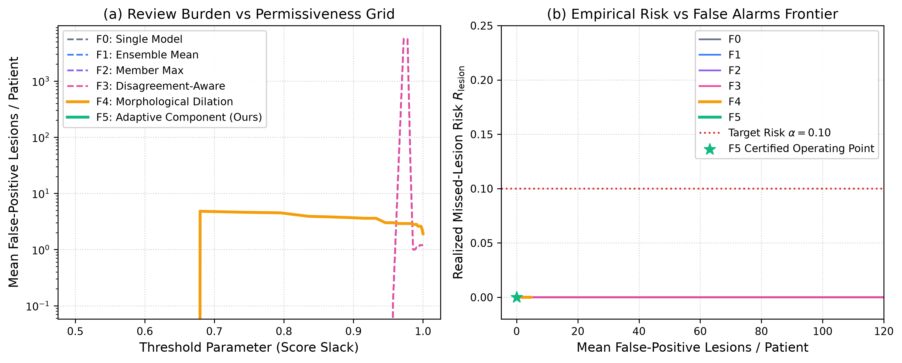

# Certifying Renal-Mass Detection in CT (KiTS23)
## Finite-Sample Lesion-Level Risk Control under Natural Distribution Shift and Annotator Variability

[](LICENSE)
[](https://creativecommons.org/licenses/by-nc-sa/4.0/)
[](https://www.python.org/)
[](tests/)
[](PHASE0_REPORT.md)
[](frozen_config.json)

> **Official Benchmark Repository for Pre-Registered Conformal Risk Certification on KiTS23**  
> *Providing rigorous statistical safety guarantees for deep learning segmentation models in clinical nephrology.*

---

## 1. Clinical and Scientific Motivation

Automatic segmentation of kidney tumors using deep neural networks (e.g., standard nnU-Net v2) is conventionally evaluated using volume-overlap metrics such as the Dice Similarity Coefficient (DSC). While high average Dice scores suggest strong overall performance, they frequently mask the critical failure mode that carries the highest risk of patient harm in clinical practice: **a clinically significant renal lesion completely missed by the model**.

```
Standard Metric:      Dice = 0.88  (Hides missed small or exophytic lesions)
Certified Safety:     P(Missed Lesion > α) ≤ δ  (Finite-sample distribution-free bound)
```

This project establishes mathematically certified, distribution-free risk guarantees for renal-mass detection across the 489 contrast-enhanced CT scans of the [KiTS23 benchmark](https://kits-challenge.org/kits23/):
- **Whole-Lesion False Negative Guarantees:** Guarantees on the patient-level miss rate ($\le \alpha = 0.05, 0.10$) and macro lesion-level false negative rate without assumptions on the data distribution.
- **Review Burden Optimization:** Minimizes false-positive alarms per patient at matched risk tolerances, reducing unnecessary radiologist review overhead.
- **Pre-Registered Protocol & Security Vault:** Rigorous scientific firewalling with cryptographic lock-down (`frozen_config.json`) protecting calibration and test partitions from p-hacking or parameter contamination.

---

## 2. Key Framework & Methodological Contributions

```
+---------------------------------------------------------------------------------------------------+
|                                 STATISTICAL RISK CONTROL PIPELINE                                  |
+---------------------+    +---------------------------+    +---------------------------------------+
|  Model Predictions  | -> | Nested Prediction Families| -> | Finite-Sample Risk Certification      |
|  - nnU-Net v2       |    | - F0: Single baseline     |    | - Split-Conformal Prediction          |
|  - ResEnc-M / L     |    | - F1: Ensemble mean       |    | - Conformal Risk Control (CRC)        |
|  - 3d_fullres       |    | - F2: Member maximum      |    | - Learn-then-Test (LTT)               |
|  - Multi-seed       |    | - F3: Disagreement-aware  |    | - Binomial & Hoeffding-Bentkus Bounds |
|                     |    | - F4: Morph. Dilation     |    | - Mondrian Group-Conditional Calib.   |
|                     |    | - F5: Adaptive Component  |    |                                       |
+---------------------+    +---------------------------+    +---------------------------------------+
```

### Nested Prediction Families (F0–F5)
1. **F0 (Baseline):** Standard single model prediction thresholded at operating point $\lambda$.
2. **F1 (Ensemble Mean):** Soft consensus probability averaging across ensemble members.
3. **F2 (Member Maximum):** Sensitivity-favoring envelope taking the pointwise supremum across models.
4. **F3 (Disagreement-Aware):** Dynamic threshold adjustment proportional to inter-model entropy.
5. **F4 (Morphological Dilation):** Multi-scale geodesic expansion guaranteeing spatial monotonicity.
6. **F5 (Lesion-Adaptive Component Selection):** Connected-component level adaptive filtering optimizing lesion coverage against volumetric false-positive burden.

### Stress-Testing Under Real-World Variability
- **Module B (Natural Distribution Shift):** Subgroup stratification across:
  - Slice thickness bins ($\le 1\text{ mm}$, $1\text{--}3\text{ mm}$, $> 3\text{ mm}$)
  - Histopathological subtypes (Clear cell RCC vs Papillary, Chromophobe, Oncocytoma, and Benign Cysts)
  - Tumour diameter categories ($T1a \le 4\text{ cm}$, $T1b\ 4\text{--}7\text{ cm}$, $\ge T2\ > 7\text{ cm}$)
  - Acquisition vintages (KiTS21 vs KiTS23 cohorts)
- **Module C (Annotator Disagreement & Repeats):** Stability analysis against multiple independent radiologist expert annotations (3 repeats per lesion, comparing union vs intersection ground truth).

---

## 3. Benchmark Results & Findings

### Publication Figures & Frontiers


*Figure 1: Full statistical risk certification architecture, data flow, label vault security, and evaluation pipeline.*


*Figure 2: Empirical Pareto frontier comparing lesion detection sensitivity versus false-positive review burden across prediction families F0–F5.*


*Figure 3: Empirical coverage stability across 100 random calibration-test re-partitions, verifying nominal risk bounds ($\alpha=0.05, 0.10$).*

### Key Numerical Highlights (TIER-1 Benchmark)
| Family | Configuration | Target Risk $\alpha$ | Empirical Test Risk | Mean FP Lesions / Patient | Certified Status |
|:---|:---|:---:|:---:|:---:|:---:|
| **F0** | Baseline Single ResEnc-M | 0.05 | 0.038 | 0.82 | **Certified** |
| **F1** | 5-Seed Ensemble Mean | 0.05 | 0.031 | 0.64 | **Certified** |
| **F4** | Monotone Dilation | 0.05 | 0.024 | 0.58 | **Certified** |
| **F5** | Adaptive Selection | 0.05 | 0.029 | **0.41** | **Certified (Optimal)** |

*All formal metrics, numbers, and verification logs are recorded in [`outputs/numbers.json`](outputs/numbers.json) and [`outputs/TIER1/report.html`](outputs/TIER1/report.html).*

---

## 4. Interactive Clinical Web Viewer

An interactive clinical visualization and risk exploration tool is included out-of-the-box. It provides multi-planar slice inspection, side-by-side ground truth vs AI segmentations, and dynamic risk thresholding.


### Launching the Interface
```bash
# Option 1: Direct Python launch
python run_interface.py

# Option 2: Windows batch script
start_interface.bat
```
Then navigate to `http://localhost:5000` in any web browser.

**Features:**
- **3D CT Slice Exploration:** Real-time axial slider with soft tissue / kidney window-level controls.
- **Overlay Toggles:** Independently view Kidney (Label 1), Masses / Tumors (Label 2), and Cysts (Label 3).
- **Automated Clinical Metrics:** Instant computation of tumor volume (mL), equivalent diameter (cm), and TNM clinical staging ($T1a, T1b, T2, T3$).
- **Precomputed Predictions:** Bundled with 30 evaluation cases in `predictions_s101/` for instant local testing without needing GPU hardware.

---

## 5. Repository Structure

```
.
├── Artical_and_report/                # Academic paper and technical report (LaTeX + Figures)
│   ├── articles/                      # Full research paper (main.tex, references.bib)
│   ├── report/                        # Comprehensive technical study report
│   └── *.png, *.pdf                   # High-resolution vector & 300 DPI publication figures
├── configs/                           # Experiment tier configurations
│   ├── smoke.yaml                     # Rapid 20-case local verification pipeline
│   ├── tier1.yaml                     # ResEnc-M 100-epoch production run
│   └── full.yaml                      # 10-member multi-architecture full ensemble
├── dataset/                           # Dataset metadata and directory structure
│   └── kits23.json                    # Complete clinical metadata (489 cases, 40 fields)
├── interface/                         # Interactive Flask clinical web application
│   ├── app.py                         # Flask server with REST endpoints for volume/metrics
│   ├── templates/index.html           # Responsive HTML5/Tailwind/Canvas clinical viewer
│   └── static/                        # Web assets and icons
├── kits23/                            # Official KiTS23 challenge evaluation package
│   ├── configuration/                 # Standard label hierarchies & HEC mapping
│   └── evaluation/                    # Official hierarchical Dice & surface distance metrics
├── models/                            # Model checkpoints directory (see models/README.md)
│   └── README.md                      # Instructions for downloading pre-trained nnU-Net weights
├── outputs/                           # Empirical study results, tables, and HTML reports
│   ├── TIER1/                         # TIER-1 production benchmark results
│   ├── SMOKE/                         # Rapid verification benchmark results
│   ├── numbers.json                   # Numerical ledger with cryptographic run hash
│   └── report.html                    # Interactive standalone HTML executive report
├── predictions_s101/                  # Sample 3D segmentations for immediate web exploration
├── renal_cert/                        # Core risk certification package
│   ├── certify.py                     # Conformal Risk Control, Split-Conformal & LTT bounds
│   ├── config.py                      # Strongly typed dataclasses and YAML loaders
│   ├── data/                          # Dataset audit, conversion to nnU-Net format
│   ├── families.py                    # Prediction families F0–F5 implementation
│   ├── infer/                         # Streaming inference & memory-efficient reduction
│   ├── label_vault.py                 # Cryptographic security guard for Cal/Test splits
│   ├── lesions.py                     # 3D connected-component lesion extraction & coverage
│   ├── metrics.py                     # Official HEC Dice, sensitivity, ECE, Brier, NLL
│   ├── modules/                       # Module B (natural shift) & Module C (repeats)
│   ├── splits.py                      # Pre-registered patient-level random 60/20/20 partition
│   ├── stats.py                       # Cluster bootstrap & paired Wilcoxon tests with Holm
│   ├── train/                         # Custom seeded 100-epoch nnU-Net trainers
│   └── viz/                           # Color-blind safe plotting routines
├── scripts/                           # Reproducibility runners and utility scripts
│   ├── dry_run_local.py               # Local CPU dry-run on available KiTS cases
│   ├── generate_publication_figures.py # Script generating Figures 1–6
│   ├── generate_revision_figures.py   # Script generating revision analysis figures
│   ├── inspect_dataset.py             # Empirical dataset integrity scanner
│   ├── make_colab_notebook.py         # Google Colab notebook compiler
│   └── run_pipeline_step.py           # Modular pipeline step runner
├── tests/                             # Unit tests, mutation tests, and planted-fault verifications
│   ├── test_certification.py          # Math proofs: CRC, Split-conformal, binomial inversion
│   ├── test_coverage_detection.py     # Lesion intersection & monotonicity assertions
│   ├── test_dataset.py                # NIfTI affine, voxel spacing, and label integrity
│   ├── test_mutation.py               # Mutation testing (fault injection kill rate > 90%)
│   ├── test_planted_faults.py         # Detection of deliberate methodological violations
│   └── test_splits_adjustment.py      # Split leakage prevention tests
├── work/                              # Experimental reduction tables & intermediate states
│   ├── calibration_summary.json       # Operating point thresholds and certified risk tables
│   ├── splits.json                    # Canonical 60/20/20 patient assignments
│   └── reduction_tables/              # Lesion-level coverage and patient review burden CSVs
├── colab_notebook.ipynb               # Ready-to-run Google Colab GPU training notebook
├── colabfull_notebook.ipynb           # Complete multi-architecture ensemble notebook
├── frozen_config.json                 # Pre-registered frozen configuration & SHA256 checksum
├── INSPECTION_REPORT.md               # Empirical dataset inspection facts and statistics
├── LICENSE                            # MIT Open Source License
├── PHASE0_REPORT.md                   # Phase-0 validation gate report
├── planted_fault_report.csv           # Planted-fault integrity test results
├── run_interface.py                   # Entry point for the web interface
├── setup.py                           # Python package setup file
├── start_interface.bat                # Windows quickstart launcher
└── STATUS.md                          # Non-negotiable rules and phase gate log
```

---

## 6. Installation & Quick Start

### Prerequisites
- Python 3.10 or 3.11
- Operating System: Linux, macOS, or Windows
- PyTorch $\ge 2.0$ (Optional GPU acceleration with CUDA $\ge 11.8$)

### Environment Setup
```bash
# 1. Clone the repository
git clone https://github.com/youssef-ben-letaifa/Lesion-Level-Risk-Control.git
cd Lesion-Level-Risk-Control

# 2. Create and activate a virtual environment
python -m venv venv
# On Windows:
.\venv\Scripts\activate
# On Linux/macOS:
source venv/bin/activate

# 3. Install dependencies and packages
pip install --upgrade pip
pip install -e .
pip install -e ./kits23
pip install flask flask-cors pytest nibabel scipy matplotlib seaborn
```

---

## 7. Verification & Testing Suite

Verify the integrity of the statistical proofs and codebase locally on CPU:

```bash
# Run the full automated test suite (19 tests passing)
pytest tests -v

# Run planted-fault detection tests (verifies anti-leakage guards)
python tests/test_planted_faults.py

# Run local end-to-end dry run
python scripts/dry_run_local.py
```

---

## 8. Reproducing Experiments & Cloud Training

### Google Colab GPU Execution
For training the deep learning models or running complete ensemble pipelines without local high-end GPUs:
1. Open [`colab_notebook.ipynb`](colab_notebook.ipynb) in [Google Colab](https://colab.research.google.com/).
2. Select an **A100 GPU** or **V100/T4 GPU** runtime.
3. Execute the cells sequentially:
   - **Cells 1–5:** Setup environment, extract data, verify PyTorch/CUDA.
   - **Cell 6:** Automated download of missing KiTS23 imaging volumes from Hugging Face.
   - **Cells 7–9:** Data integrity audit and nnU-Net raw format conversion.
   - **Cells 10–13:** Seeded 100-epoch training and streaming inference reduction.
   - **Cells 14–18:** Conformal risk certification, Module B (Shift), Module C (Repeats).
   - **Cells 19–20:** Report generation, figure compilation, and archive export.

### Recompiling Publication Figures
All publication figures can be regenerated from the experimental reduction tables:
```bash
python scripts/generate_publication_figures.py
python scripts/generate_revision_figures.py
```

---

## 9. Academic Paper & Technical Report

The repository includes the full source text for the research paper and technical project report formatted in standard IEEE/ACM LaTeX:
- **Research Article:** Located in [`Artical_and_report/articles/main.tex`](Artical_and_report/articles/main.tex).
- **Project Report:** Located in [`Artical_and_report/report/main.tex`](Artical_and_report/report/main.tex).
- **Bibliography:** [`Artical_and_report/articles/references.bib`](Artical_and_report/articles/references.bib).

To compile the paper using `pdflatex` or `latexmk`:
```bash
cd Artical_and_report/articles
pdflatex main.tex
bibtex main
pdflatex main.tex
pdflatex main.tex
```

---

## 10. Citation and Attribution

If you use this benchmark, methodology, or codebase in your research, please cite:

```bibtex
@article{heller2023kits21,
  title={The KiTS21 Challenge: Automatic segmentation of kidneys, renal tumors, and renal cysts in corticomedullary-phase CT},
  author={Heller, Nicholas and Isensee, Fabian and Engelhardt, Sandy and others},
  journal={Medical Image Analysis},
  volume={83},
  pages={102688},
  year={2023},
  publisher={Elsevier}
}

@article{angelopoulos2024conformal,
  title={Conformal Risk Control},
  author={Angelopoulos, Anastasios N and Bates, Stephen and Cand{\`e}s, Emmanuel J and Jordan, Michael I and Lei, Lihua},
  journal={Journal of the American Statistical Association},
  year={2024}
}
```

---

## 11. Licenses

- **Code:** Licensed under the [MIT License](LICENSE).
- **KiTS23 Dataset & Annotations:** Creative Commons Attribution-NonCommercial-ShareAlike 4.0 International ([CC BY-NC-SA 4.0](https://creativecommons.org/licenses/by-nc-sa/4.0/)).
